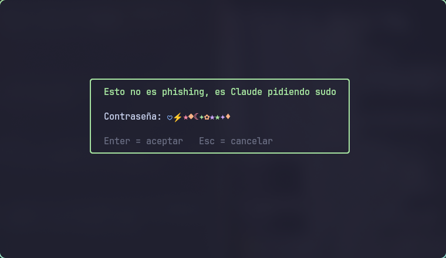
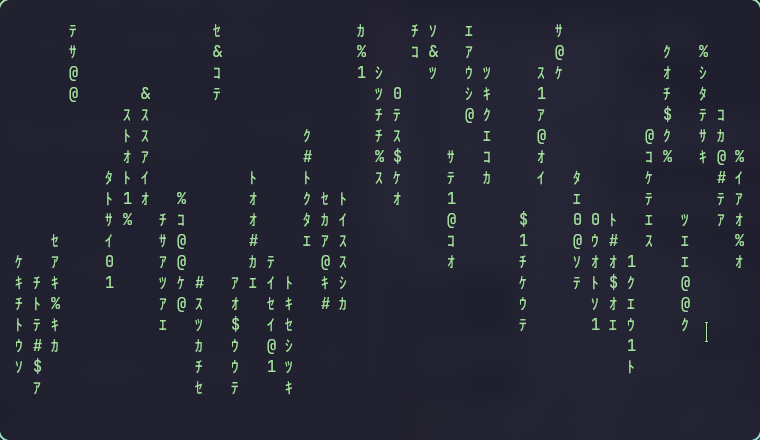
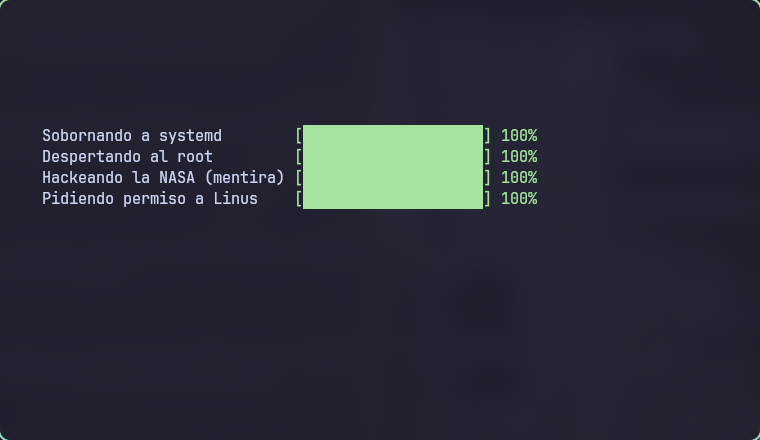

<div align="center">



<br/><br/>


### Cuando Claude Code necesita `sudo`, te lo pide con estilo.

**Una intro distinta cada vez, un sonido que nunca se repite y, de vez en cuando, un susto.**
<br/>
**Sin dependencias: Python stdlib, kitty y PipeWire.**

<br/>

[](#-como-funciona)
[](#-instalar)
[](#-por-que-existe)
[](./frases.txt)

<br/>

[](LICENSE)

[**Por qué existe**](#-por-que-existe) • [**Efectos**](#-efectos) • [**Instalar**](#-instalar) • [**Cómo funciona**](#-como-funciona) • [**Frases**](#-agregar-frases)

</div>

<br/>

## 💡 Por que existe

Claude Code corre sin terminal interactiva, así que un `sudo` normal se queda
esperando una contraseña que nadie puede escribir. La solución estándar es
`sudo -A`: sudo llama a un programa (`SUDO_ASKPASS`) que muestra una ventana y
devuelve la contraseña.

Este repo es ese programa, pero con personalidad: en vez de un cuadro gris
igual cada vez, cada pedido de sudo es un pequeño show distinto. Y como la
contraseña la escribe la persona en su propia pantalla, nunca pasa por el chat.

## ✨ Efectos

<table>
<tr>
<td width="50%"></td>
<td width="50%"></td>
</tr>
<tr>
<td align="center"><sub>Lluvia tipo Matrix</sub></td>
<td align="center"><sub>"Sobornando a systemd", "Pidiendo permiso a Linus"...</sub></td>
</tr>
</table>

- **Seis intros al azar:** Matrix, máquina de escribir con clics, hackeo falso
  con barras de progreso, viaje entre estrellas, un gatito que cruza la ventana
  y la frase ondulando en arcoíris.
- **Sonido sintetizado en el momento:** melodías con escalas al azar (mayor,
  menor, japonesa, árabe) y ondas seno, cuadrada o diente de sierra; a veces
  una moneda o un power-up. No hay archivos de audio: todo se genera con el
  módulo `wave`.
- **Contraseña enmascarada con símbolos de colores** (✦ ★ ♥ ⚡ ♪...), uno
  distinto por tecla.
- **Un título al azar** de [`frases.txt`](./frases.txt) en cada pedido.
- **El borde toma el acento del día** si existe `~/.config/waybar/accent.css`.
- **Susto con 8% de probabilidad:** "cargando..." con calma, y de golpe
  flashes, una cara y una alarma.

## 📦 Instalar

Requisitos: `python3`, `kitty`, `pw-play` (PipeWire) y `zenity` como respaldo.

```sh
git clone https://github.com/Mickaell22/claude-sudo-askpass
ln -sf "$PWD/claude-sudo-askpass/sudo-askpass" ~/.local/bin/sudo-askpass
```

En `~/.claude/settings.json`:

```json
{ "env": { "SUDO_ASKPASS": "/home/<usuario>/.local/bin/sudo-askpass" } }
```

Y pedile a Claude que use siempre `sudo -A` (por ejemplo en tu `CLAUDE.md`).

En Hyprland, para que la ventana flote centrada y encima de todo:

```
windowrule = float on, match:class ^(sudo-askpass)$
windowrule = size 760 440, match:class ^(sudo-askpass)$
windowrule = center on, match:class ^(sudo-askpass)$
windowrule = pin on, match:class ^(sudo-askpass)$
```

## ⚙️ Como funciona

```
sudo -A  ─▶  sudo-askpass  ─▶  kitty --class sudo-askpass  ─▶  askpass.py
                  │                                               │
                  │◀──── archivo en $XDG_RUNTIME_DIR (0700) ◀─────┘
                  ▼
           stdout ─▶ sudo
```

- `sudo-askpass` (sh) elige la frase, abre la ventana y espera.
- `askpass.py` (solo stdlib) corre la intro y el sonido, lee las teclas en modo
  raw y escribe la contraseña en un archivo dentro de un directorio `0700` de
  `$XDG_RUNTIME_DIR` (tmpfs, en memoria). El script lo lee, se lo pasa a sudo y
  lo borra.
- Enter acepta, Esc o Ctrl+C cancela, Ctrl+U borra todo.
- **Si no hay Wayland, falta kitty o algo falla, cae a `zenity --password`**: un
  efecto roto nunca te deja sin sudo.

## 📝 Agregar frases

Una por línea en [`frases.txt`](./frases.txt). Se elige una al azar con `shuf`.
